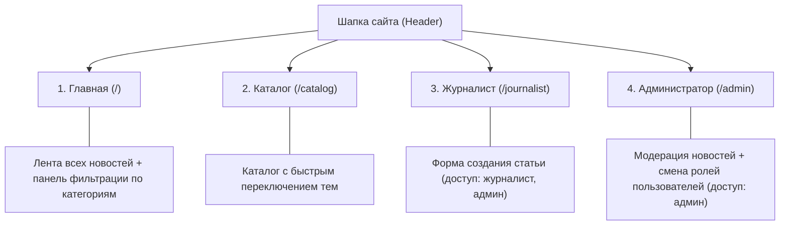

# Продуктовая спецификация: Новостной портал на Laravel
*Файл: `docs/PRODUCT_SPEC.md` | Версия: 1.1 | Статус: Утверждено*

---

## 1. Концепция и цель продукта

**Новостной портал** — это веб-приложение для публикации, категоризации и чтения актуальных новостей и аналитических статей.  
Проект разработан для демонстрации компетенций веб-разработки на современном PHP-фреймворке Laravel с соблюдением принципа «студента 3 пар»: чистый, выразительный код, высокая автономность и отсутствие избыточных усложнений (overengineering).

---

## 2. Философия продукта: «Читатель по умолчанию»

Ключевой продуктовый принцип:
> **Каждый посетитель сайта — уже читатель.**

* **Для гостей нет барьеров**: любому пользователю, открывшему сайт, сразу доступны все опубликованные статьи, фильтрация по темам и каталог. Никакой принудительной регистрации или баннеров «Войдите, чтобы прочитать».
* **Вход — только для редакции**: авторизация требуется исключительно авторам (Журналистам) и модераторам (Администраторам) для доступа к служебным функциям.

---

## 3. Роли пользователей и матрица прав

| Роль | Как получить | Доступные разделы | Возможности |
|---|---|---|---|
| 👤 **Читатель / Гость** | По умолчанию при входе на сайт | Главная (`/`), Каталог (`/catalog`) | Просмотр ленты, чтение статей, фильтрация по категориям (ИИ, Технологии, Космос, Наука) |
| ✍️ **Журналист (`journalist`)** | Вход через форму или быстрый логин | Главная, Каталог, Панель журналиста (`/journalist`) | Все права читателя + создание и публикация новых новостей |
| 👑 **Администратор (`admin`)** | Вход через форму или быстрый логин | Все разделы сайта + Админ-панель (`/admin`) | Полный доступ: модерация (редактирование и удаление) любых новостей, просмотр статистики, назначение и смена ролей пользователей |

---

## 4. Структура разделов сайта

В шапке сайта (`<x-header />`) зафиксированы 4 основных раздела:

### 1. Главная страница (`/`)
* **Назначение**: Центральная витрина портала.
* **Элементы**:
  * Верхняя панель фильтрации по темам: кнопки-теги («Все темы», «Искусственный интеллект», «Технологии», «Космос», «Наука») и выпадающий список `<select>`.
  * Сетка карточек новостей (`<x-news-card />`): бейдж рубрики с уникальным цветом, номер статьи `№ ID`, дата публикации, заголовок и анонс текста.

### 2. Каталог (`/catalog`)
* **Назначение**: Тематический рубрикатор.
* **Элементы**:
  * Выбор интересующей рубрики.
  * Вывод новостей, относящихся исключительно к выбранной теме.

### 3. Раздел «Журналист» (`/journalist`)
* **Назначение**: Рабочее место автора статей.
* **Доступ**: только для ролей `journalist` и `admin`.
* **Форма публикации**:
  * Поле **«Заголовок статьи»** (обязательное, до 255 символов).
  * Выпадающий список **«Тема / Категория»**.
  * Текстовая область **«Текст статьи»** (обязательное).
  * Кнопка **«Опубликовать статью»**.
* **Результат**: после успешной отправки происходит редирект на главную страницу с зелёным уведомлением об успехе.

### 4. Раздел «Администратор» (`/admin`)
* **Назначение**: Центр управления контентом и безопасностью.
* **Доступ**: строго для роли `admin`.
* **Функционал**:
  * **Виджеты статистики**: общее количество новостей и число авторов.
  * **Таблица модерации контента**: список всех публикаций с датой, категорией и действиями («Редактировать» `/admin/news/{id}/edit`, «Удалить»).
  * **Таблица управления пользователями**: список зарегистрированных пользователей с возможностью изменить роль (`user`, `journalist`, `admin`) прямо через выпадающий список на лету.

---

## 5. Пользовательские сценарии (User Flows)

### Сценарий А: Чтение новостей гостем
1. Посетитель переходит на сайт `http://127.0.0.1:8000`.
2. В шапке отображается статус: `👤 Читатель` и кнопка `Вход для редакции`.
3. Посетитель нажимает на фильтр «Космос» — лента мгновенно фильтрует новости без перезагрузки или через GET-параметр `?category=Космос`.

### Сценарий Б: Публикация статьи журналистом
1. Пользователь нажимает `Вход для редакции` (или кнопку быстрого входа `✍️ Войти как Журналист`).
2. В шапке появляется статус `✍️ Иван Журналист` и кнопка `Выйти`.
3. Пользователь кликает в шапке на пункт `Журналист`.
4. Заполняет поля формы и нажимает `Опубликовать статью`.
5. Статья мгновенно появляется в общей ленте на главной странице под своим уникальным номером.

### Сценарий В: Модерация и управление ролями админом
1. Администратор заходит в раздел `Администратор`.
2. Нажимает «Редактировать» у нужной статьи, правит заголовок и сохраняет.
3. В таблице пользователей выбирает зарегистрированного читателя и меняет его роль на «Журналист». Пользователь получает права на публикацию.
