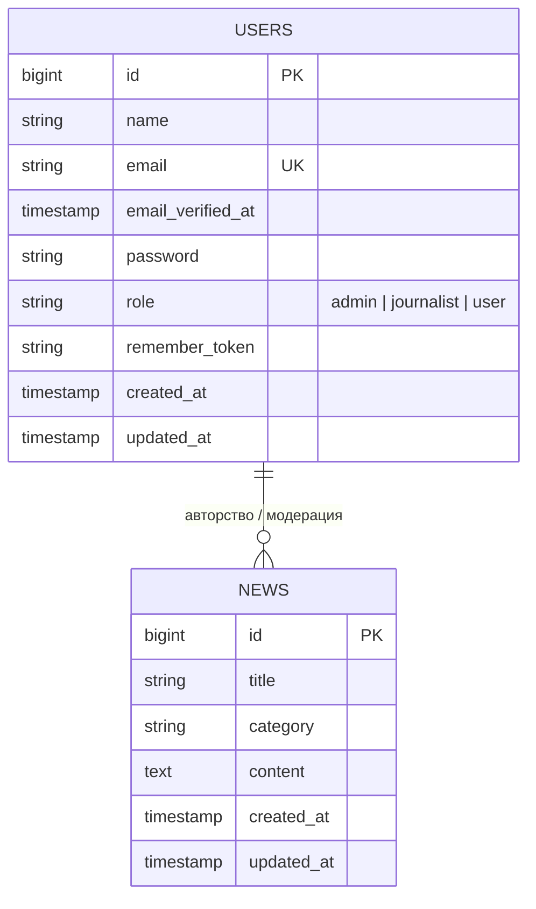

# Техническая спецификация: Архитектура новостного портала
*Файл: `docs/SPEC.md` | Версия: 1.1 | Статус: Утверждено*

---

## 1. Стек технологий и окружение

* **Язык**: PHP 8.3+ (CLI / Built-in server)
* **Фреймворк**: Laravel 11 / 12
* **База данных**: SQLite 3 (файл: `database/database.sqlite`, для тестов: `:memory:`)
* **Шаблонизатор**: Laravel Blade (компонентная архитектура `<x-... />`)
* **Стилизация**: Автономный чистый CSS внутри `<x-layout />` (без зависимости от внешних сборщиков Vite, Node.js или CDN)
* **Аутентификация**: Встроенная подсистема `Illuminate\Support\Facades\Auth` + Bcrypt хеширование

---

## 2. Схема базы данных



### Таблица `users` (Миграция: `0001_01_01_000000_create_users_table.php`)
| Колонка | Тип | Атрибуты | Описание |
|---|---|---|---|
| `id` | `bigint unsigned` | Primary Key, Auto Increment | Уникальный ID пользователя |
| `name` | `varchar(255)` | Not Null | Имя пользователя |
| `email` | `varchar(255)` | Unique, Not Null | Почтовый адрес (логин) |
| `password` | `varchar(255)` | Not Null | Хеш пароля (Bcrypt) |
| `role` | `varchar(50)` | Default: `'user'` | Роль: `admin`, `journalist`, `user` |
| `timestamps`| `timestamp` | Nullable | Время создания и обновления |

### Таблица `news` (Миграция: `2026_09_27_182241_create_news_table.php`)
| Колонка | Тип | Атрибуты | Описание |
|---|---|---|---|
| `id` | `bigint unsigned` | Primary Key, Auto Increment | Номер публикации (`№ ID`) |
| `title` | `varchar(255)` | Not Null | Заголовок статьи |
| `category`| `varchar(100)` | Default: `'Искусственный интеллект'` | Рубрика каталога |
| `content` | `text` | Not Null | Полный текст статьи |
| `timestamps`| `timestamp` | Nullable | Дата и время публикации |

---

## 3. Таблица маршрутов (`routes/web.php`)

```mermaid
flowchart TD
    Req[Входящий HTTP Запрос] --> Router{routes/web.php}
    
    Router -->|GET /| Home[NewsController@index]
    Router -->|GET /catalog| Catalog[NewsController@catalog]
    
    Router -->|GET,POST /login| AuthLogin[AuthController@login]
    Router -->|GET,POST /register| AuthReg[AuthController@register]
    Router -->|POST /logout| AuthOut[AuthController@logout]
    Router -->|GET /quick-login/{role}| Quick[AuthController@quickLogin]
    
    Router -->|Middleware: auth + role:journalist,admin| M1{Охранник 1}
    M1 -->|GET /journalist| JForm[NewsController@journalist]
    M1 -->|POST /journalist| JStore[NewsController@store]
    
    Router -->|Middleware: auth + role:admin| M2{Охранник 2}
    M2 -->|GET /admin| APanel[NewsController@admin]
    M2 -->|GET /admin/news/{news}/edit| AEdit[NewsController@edit]
    M2 -->|PUT /admin/news/{news}| AUpdate[NewsController@update]
    M2 -->|DELETE /admin/news/{news}| ADestroy[NewsController@destroy]
    M2 -->|PATCH /admin/users/{user}/role| ARole[NewsController@updateUserRole]
```

---

## 4. Контроллеры и бизнес-логика

### `NewsController` (`app/Http/Controllers/NewsController.php`)
1. `index(Request $request)`: получение списка новостей с опциональной фильтрацией `category`, извлечение уникальных категорий для фильтра, рендеринг `pages.home`.
2. `catalog(Request $request)`: отображение каталога рубрик, выборка новостей по выбранной теме, рендеринг `pages.catalog`.
3. `journalist()`: отображение формы добавления новости (`pages.journalist`).
4. `store(Request $request)`:
   * Валидация: `title` (required, max:255), `content` (required), `category` (nullable).
   * Сохранение: `News::create($validated)`.
   * Редирект на `home` с flash-сообщением об успехе.
5. `admin()`: агрегация данных для администратора (`News::latest()->get()`, `User::latest()->get()`), вывод `pages.admin`.
6. `edit(News $news)`: показ формы редактирования (`pages.news-edit`).
7. `update(Request $request, News $news)`: валидация и обновление статьи через `$news->update(...)`.
8. `destroy(News $news)`: удаление статьи через `$news->delete()`.
9. `updateUserRole(Request $request, User $user)`:
   * Валидация: `role` (in:admin,journalist,user).
   * Защита: проверка `$user->id !== auth()->id()`, чтобы администратор случайно не лишил прав самого себя.
   * Обновление роли пользователя.

### `AuthController` (`app/Http/Controllers/AuthController.php`)
1. `login(Request $request)`: валидация почты и пароля, `Auth::attempt(...)`, регенерация сессии.
2. `register(Request $request)`: создание нового пользователя с ролью `user` по умолчанию, автоматическая авторизация.
3. `logout(Request $request)`: сброс сессии, инвалидация токена CSRF, выход из системы.
4. `quickLogin(string $role)`: мгновенный вход в 1 клик для демонстрации преподавателю.
5. `ensureUserExists(string $role)`: механизм самоисцеления базы данных. Если при быстром входе база пуста или пользователь не найден — автоматически накатываются миграции и сиды.

---

## 5. Архитектура Middleware (`RoleMiddleware.php`)

Зарегистрирован в `bootstrap/app.php` под алиасом `'role'`:
* Проверяет `auth()->check()`: если пользователь не вошел, редиректит на `/login` с поясняющим сообщением.
* Проверяет `$user->role` на вхождение в переданный список разрешенных ролей: `in_array($user->role, $roles)`.
* Если прав недостаточно, вызывает `abort(403, 'Доступ запрещен...')`.

---

## 6. Безопасность и отказоустойчивость

1. **CSRF-защита**: все POST/PUT/DELETE формы содержат `@csrf` (скрытый токен `_token`).
2. **SQL Injection**: запросы выполняются исключительно через Eloquent ORM с параметризованными биндингами.
3. **XSS-защита**: вывод данных в Blade шаблонах через `{{ $variable }}` с автоматическим экранированием `htmlspecialchars`.
4. **Безотказный запуск (Plug-and-play)**:
   * Файл SQLite-базы включен в репозиторий.
   * `DatabaseSeeder` использует `User::firstOrCreate(...)` для исключения ошибок дублирования при повторном запуске.
   * `start.bat` автоматически разворачивает проект и поднимает сервер на Windows в один клик.
