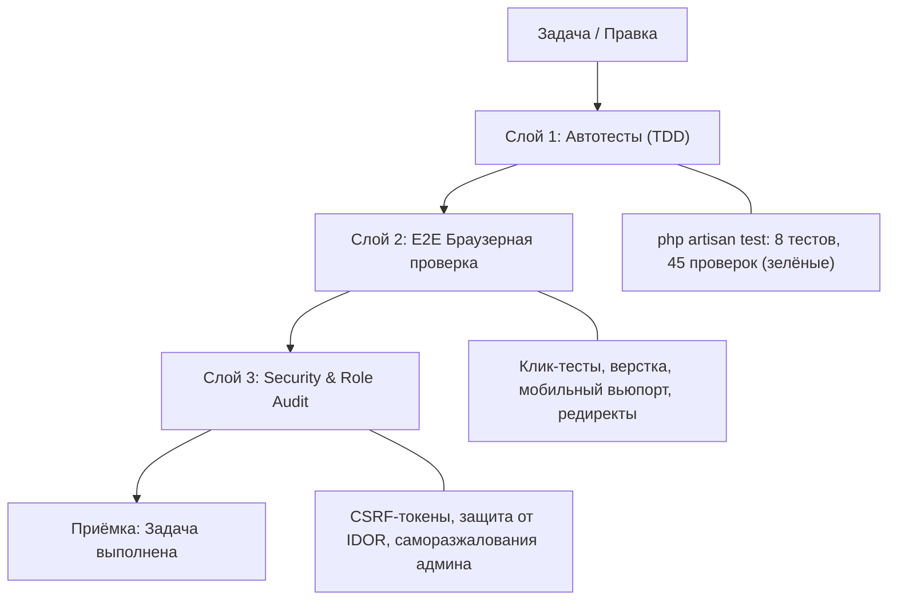

# Регламент разработки и 3-слойной верификации (Verification Protocol)
*Файл: `docs/WORKFLOW_AND_VERIFICATION.md` | Статус: Актуально*

Регламент составлен по методологии Vibecoding и скилла `task-verification`. Любая задача, багфикс или доработка проекта признаётся завершённой **только при наличии объективных доказательств** прохождения 3 слоёв проверки.

---

## 1. Три слоя проверки (3-Layer Verification)

| Слой | Инструмент | Что верифицируется в проекте |
|---|---|---|
| **Слой 1: Автотесты** | PHPUnit / `php artisan test` | Доступность маршрутов, фильтрация новостей, изоляция ролей (403), сохранение в БД, автоисцеление базы при пустом хранилище |
| **Слой 2: Браузерный E2E** | Playwright MCP / Ручной UI тест | Корректность отображения карточек, цветовые бейджи рубрик, работа кнопок быстрого входа в 1 клик, отсутствие сдвигов верстки |
| **Слой 3: Безопасность (Security)** | Статический аудит кода | Наличие `@csrf` во всех формах, защита паролей хешированием Bcrypt, запрет на снятие админом роли с самого себя |

---

## 2. Матрица негативных тест-кейсов (6 векторов отказа)

Для защиты от скрытых дефектов сформулированы обязательные сценарии для тестирования:

| Вектор отказа | Тест-кейс для новостного сайта | Ожидаемое поведение системы |
|---|---|---|
| **1. Пустые данные (Empty / Null)** | Отправка формы создания новости с пустым заголовком или текстом | Валидатор отклоняет запрос, возвращает ошибку, данные не попадают в БД |
| **2. Невалидный формат данных** | Попытка передать несуществующую роль (`hacker`) через форму смены ролей | Валидатор `in:admin,journalist,user` возвращает 422 ошибку |
| **3. Граничные значения & стресс** | Заголовок статьи длиной более 255 символов; текст статьи на 50 000 символов | Поле `max:255` блокирует превышение заголовка, а поле `text` корректно вмещает большой текст без поломки верстки карточки |
| **4. Повторные клики и гонки** | Множественный клик по кнопке быстрого входа или запуск сидера при готовой базе | Метод `firstOrCreate` исключает ошибку `UNIQUE constraint failed`, пользователь авторизуется штатно |
| **5. Сбои окружения и зависимостей** | Запуск сайта на ПК без `.env` или с удаленным файлом `database.sqlite` | Механизм `ensureUserExists()` и fallback в `config/app.php` восстанавливают окружение без белого экрана и ошибки 500 |
| **6. Нарушение бизнес-правил (IDOR)** | Обычный читатель пытается напрямую отправить POST-запрос на `/journalist` или PATCH на `/admin/users/1/role` | `RoleMiddleware` пресекает попытку и возвращает статус `403 Forbidden` |

---

## 3. Регламент приемки и формат отчета (Acceptance Report)

При завершении любого этапа разработки формируется отчет со следующей структурой:
1. **Что реализовано**: перечень добавленных/измененных файлов.
2. **Фактические доказательства**:
   * Вывод `php artisan test` (количество пройденных тестов и проверок).
   * Результат визуальной проверки в браузере.
   * Проверка безопасности (отсутствие уязвимостей и секретов).
3. **Статус техдолга**: отсутствие скрытого долга.
