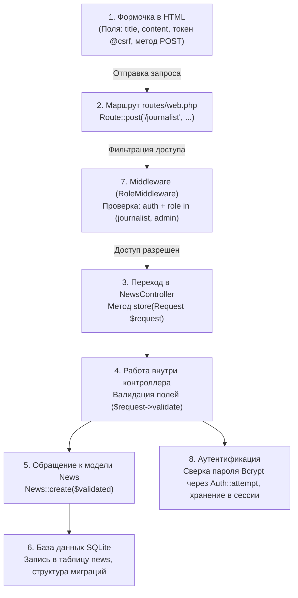

# Исследование: Расшифровка и разбор требований преподавателя
*Файл: `docs/research/teacher_audio_transcript.md` | Источник: Аудиозапись с пары*

---

## 1. Дословная стенограмма аудиозаписи

> **[00:00 – 00:08]**  
> *«На три диктофона, да? Секунду. Хорошо. Пошло. Пошло. Так, раз, два, два диктофона целых слушают меня. Значит, следующее:*  
>  
> **[00:09 – 00:23]**  
> *Мне важно, чтобы вы понимали, что у вас зачем следует:*  
> *1. Как у вас работает формочка HTML?*  
> *2. Что она вызывает по `web.php`?*  
> *3. Как она идет в контроллер?*  
> *4. Что происходит в контроллере?*  
> *5. Как контроллер работает с моделями?*  
>  
> **[00:24 – 00:26]**  
> *(Студент: «А всё на троечку?»)*  
> *Преподаватель: «Это не на троечку, это просто надо рассказать. Дальше идем.*  
>  
> **[00:27 – 00:40]**  
> *6. Разобрались с моделями. Именно с моделями, разбираемся со связями, базами данных и так далее. Объясняете, как вы связывали таблички, как вы сделали базу данных свою.*  
>  
> **[00:41 – 00:45]**  
> *7. Объяснили это — сделали объяснение по мидлвеерам (middleware). Объяснили, как работают мидлвееры.*  
>  
> **[00:46 – 00:53]**  
> *8. Не забыли про авторизацию мне рассказать, как работает у вас авторизация.*  
> *И, в принципе, на этом как бы всё, что вы мне должны рассказать.*  
>  
> **[00:54 – 01:00]**  
> *Всё, можете заканчивать меня писать.»*

---

## 2. Декомпозиция 8 вопросов в единую логическую цепочку

Преподаватель требует понимания **жизненного цикла HTTP-запроса (Request Lifecycle)** в Laravel на примере формы создания публикации.

---

## 3. Таблица шпаргалки для студента при ответе

| № | Вопрос преподавателя | Ответ студента (2 предложения) | Файл в проекте для показа |
|---|---|---|---|
| **1** | **Как работает формочка HTML?** | Форма использует метод `POST` и обязательную директиву `@csrf` для защиты от межсайтовой подделки запросов. Поля содержат атрибуты `name` (`title`, `content`), по которым сервер считывает переданные данные. | `resources/views/pages/journalist.blade.php` |
| **2** | **Что она вызывает по `web.php`?** | Запрос отправляется на адрес `/journalist`. В `routes/web.php` маршрут перехватывает этот `POST`-запрос и направляет его в метод `store` класса `NewsController`. | `routes/web.php` |
| **3** | **Как она идет в контроллер?** | Фреймворк сопоставляет URL с таблицей маршрутов, собирает все параметры формы в объект `$request` и передает его аргументом в соответствующий метод контроллера. | `app/Http/Controllers/NewsController.php` |
| **4** | **Что происходит в контроллере?** | Сначала контроллер проверяет входные данные методом `$request->validate()` (не пустые ли заголовок и текст). Если всё корректно, он передаёт данные в модель, а затем делает редирект с флеш-сообщением об успехе. | `app/Http/Controllers/NewsController.php` |
| **5** | **Как контроллер работает с моделями?** | Через Eloquent ORM: модель `News` является представлением таблицы `news`. Контроллер вызывает методы модели: `News::create()` для вставки, `News::latest()->get()` для выборки и `$news->delete()` для удаления. | `app/Models/News.php` |
| **6** | **Как устроена база данных и связи?** | База данных работает на SQLite в файле `database.sqlite`, структура задана миграциями. В таблице `users` есть колонка `role` для разграничения прав, а у новостей — поле категории для фильтрации. | `database/migrations/2026_09_27_182241_create_news_table.php` |
| **7** | **Как работают middleware?** | Middleware — это фильтр-посредник перед контроллером. Наш `RoleMiddleware` проверяет: если гость пробует зайти в редактор, его отправляет на `/login`, а если читатель пытается зайти в админку — возвращается ошибка `403 Forbidden`. | `app/Http/Middleware/RoleMiddleware.php` |
| **8** | **Как работает авторизация?** | Посетители сайта по умолчанию читатели. Для сотрудников редакции выполняется проверка логина и пароля через `Auth::attempt()`, пароль сверяется с захешированным в базе значением, и создается защищенная сессия. | `app/Http/Controllers/AuthController.php` |
